# ⚡ NEXUS ARENA — SYSTEM ARCHITECTURE

### Secure Authentication Ecosystem + Real-Time Multiplayer Gaming Platform

---

## 01. PROJECT OVERVIEW

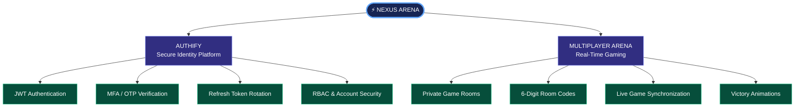

---

## 02. COMPLETE TECHNOLOGY STACK

```mermaid
flowchart TB
    ROOT["NEXUS ARENA TECHNOLOGY STACK"]

    ROOT --> FRONTEND["FRONTEND"]
    ROOT --> BACKEND["BACKEND"]
    ROOT --> DATABASE["DATA LAYER"]
    ROOT --> INFRA["INFRASTRUCTURE"]

    FRONTEND --> F1["React 18"]
    FRONTEND --> F2["Vite"]
    FRONTEND --> F3["Tailwind CSS"]
    FRONTEND --> F4["Context API"]
    FRONTEND --> F5["Axios"]
    FRONTEND --> F6["STOMP + SockJS"]

    BACKEND --> B1["Java 21"]
    BACKEND --> B2["Spring Boot 3"]
    BACKEND --> B3["Spring Security 6"]
    BACKEND --> B4["Spring WebSocket"]
    BACKEND --> B5["Hibernate / JPA"]
    BACKEND --> B6["Swagger / OpenAPI"]

    DATABASE --> D1[("PostgreSQL")]
    DATABASE --> D2[("Redis")]
    DATABASE --> D3["Flyway Migrations"]

    INFRA --> I1["Docker"]
    INFRA --> I2["Vercel"]
    INFRA --> I3["Render / Fly.io"]
    INFRA --> I4["Supabase"]
    INFRA --> I5["Upstash Redis"]
    INFRA --> I6["Gmail SMTP"]

    classDef root fill:#172554,stroke:#60a5fa,color:#fff
    classDef category fill:#312e81,stroke:#818cf8,color:#fff
    classDef tech fill:#1f2937,stroke:#64748b,color:#fff

    class ROOT root
    class FRONTEND,BACKEND,DATABASE,INFRA category
    class F1,F2,F3,F4,F5,F6,B1,B2,B3,B4,B5,B6,D1,D2,D3,I1,I2,I3,I4,I5,I6 tech
```

---

## 03. HIGH-LEVEL SYSTEM ARCHITECTURE

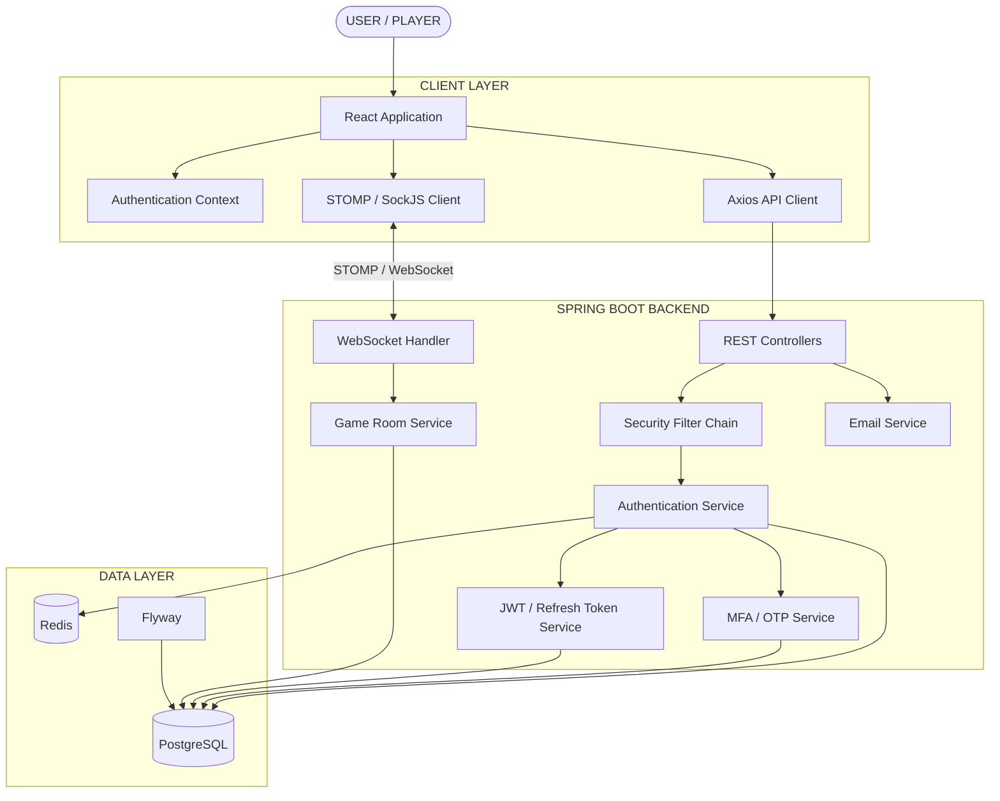

---

## 04. AUTHENTICATION & SECURITY FLOW

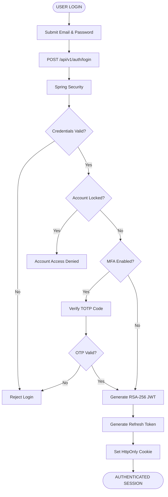

### SECURITY COMPONENTS

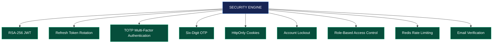

---

## 05. REFRESH TOKEN ROTATION

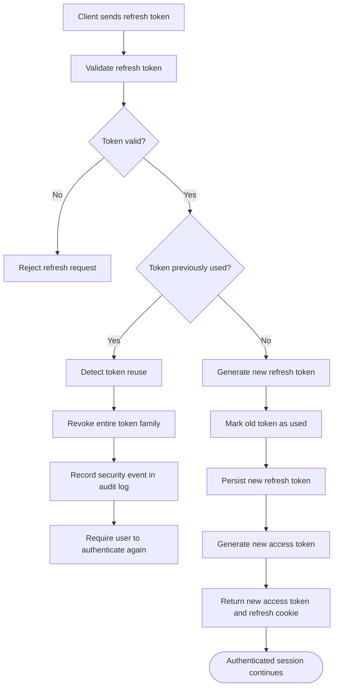

---

## 06. REAL-TIME MULTIPLAYER GAME ARCHITECTURE

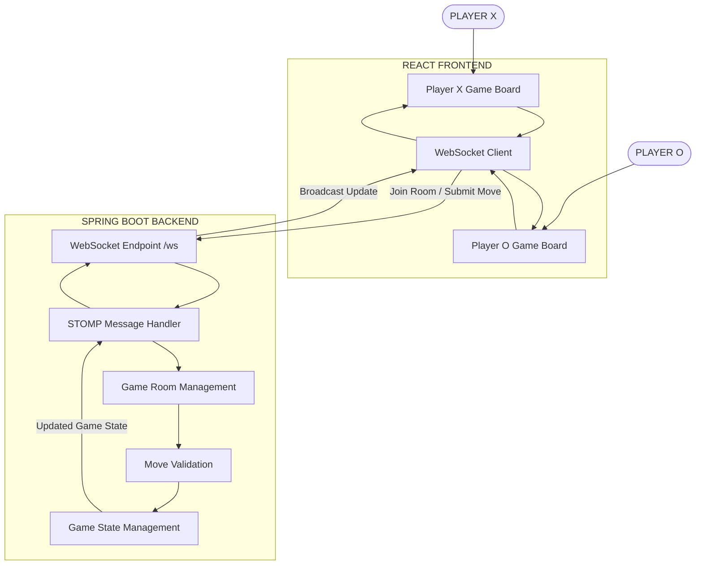

### GAME LIFECYCLE

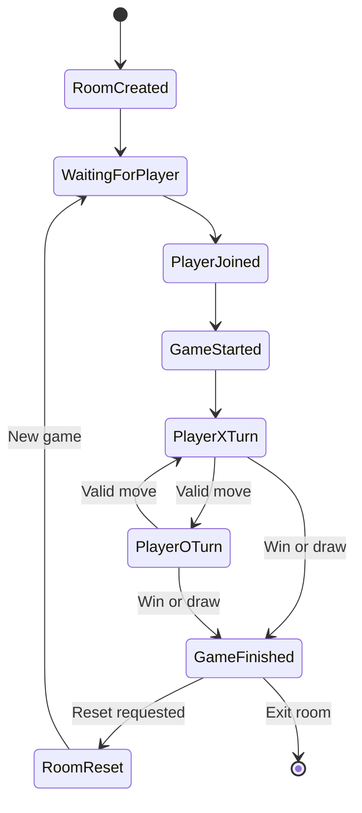

---

## 07. WEBSOCKET EVENT COMMUNICATION

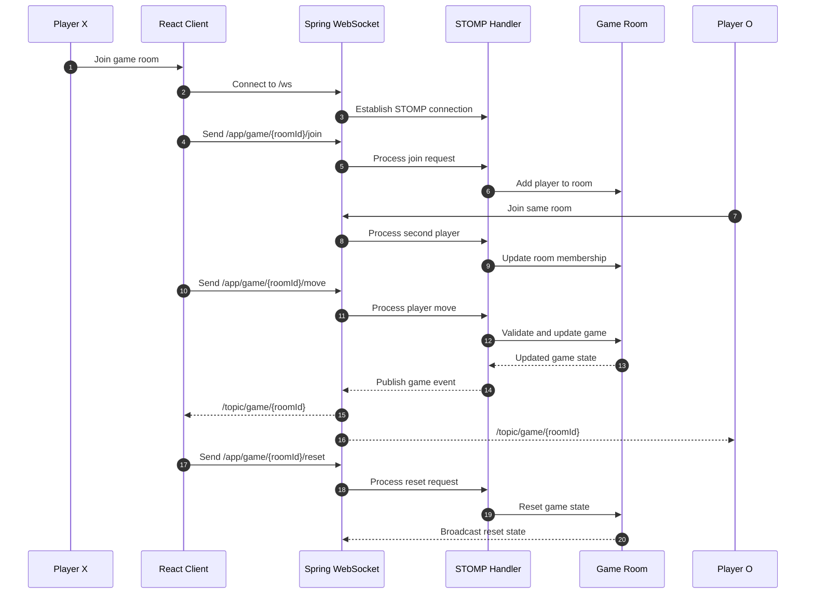

---

## 08. DATABASE ARCHITECTURE

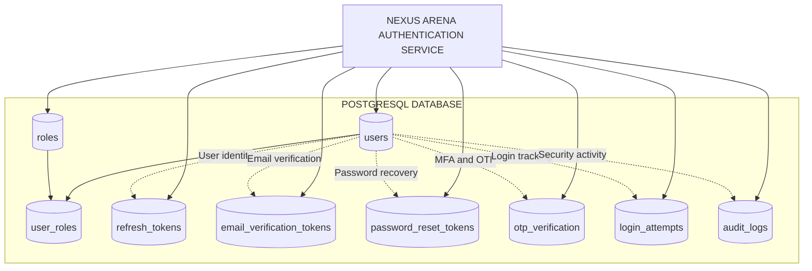

### DATABASE TECHNOLOGIES

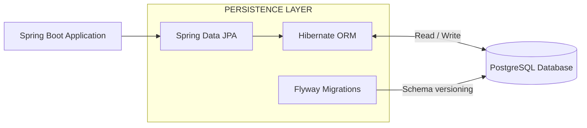

---

## 09. BACKEND API ARCHITECTURE

```mermaid
flowchart TB
    ROOT["REST API /api/v1"]

    ROOT --> AUTH["AUTH CONTROLLER"]
    ROOT --> USERS["USER CONTROLLER"]
    ROOT --> ADMIN["ADMIN CONTROLLER"]

    subgraph AUTH_API["AUTHENTICATION ENDPOINTS"]
        A1["POST /register"]
        A2["POST /login"]
        A3["POST /refresh"]
        A4["POST /logout"]
        A5["POST /mfa/verify-login"]
        A6["GET /me"]
        A7["GET /verify-email"]
        A8["POST /forgot-password"]
        A9["POST /reset-password"]
    end

    subgraph USER_API["USER ENDPOINTS"]
        U1["POST /change-password"]
        U2["POST /change-email"]
        U3["POST /mfa/setup"]
        U4["POST /mfa/verify"]
        U5["POST /mfa/disable"]
        U6["POST /otp/send"]
        U7["POST /otp/verify"]
    end

    subgraph ADMIN_API["ADMIN ENDPOINTS - ROLE_ADMIN"]
        D1["GET /"]
        D2["POST /users/{userId}/lock"]
        D3["POST /users/{userId}/unlock"]
        D4["PATCH /users/{userId}/roles"]
    end

    AUTH --> A1
    AUTH --> A2
    AUTH --> A3
    AUTH --> A4
    AUTH --> A5
    AUTH --> A6
    AUTH --> A7
    AUTH --> A8
    AUTH --> A9

    USERS --> U1
    USERS --> U2
    USERS --> U3
    USERS --> U4
    USERS --> U5
    USERS --> U6
    USERS --> U7

    ADMIN --> D1
    ADMIN --> D2
    ADMIN --> D3
    ADMIN --> D4
```

### WEBSOCKET API

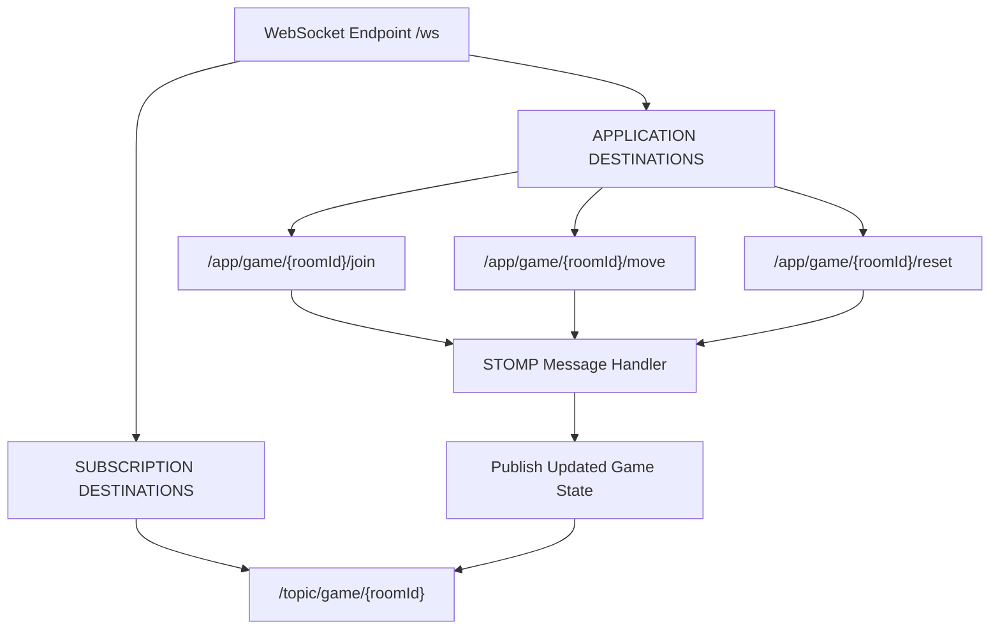

---

## 10. COMPLETE PROJECT DIRECTORY

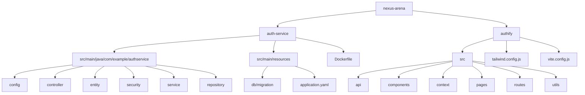

---

## 11. CLOUD DEPLOYMENT ARCHITECTURE

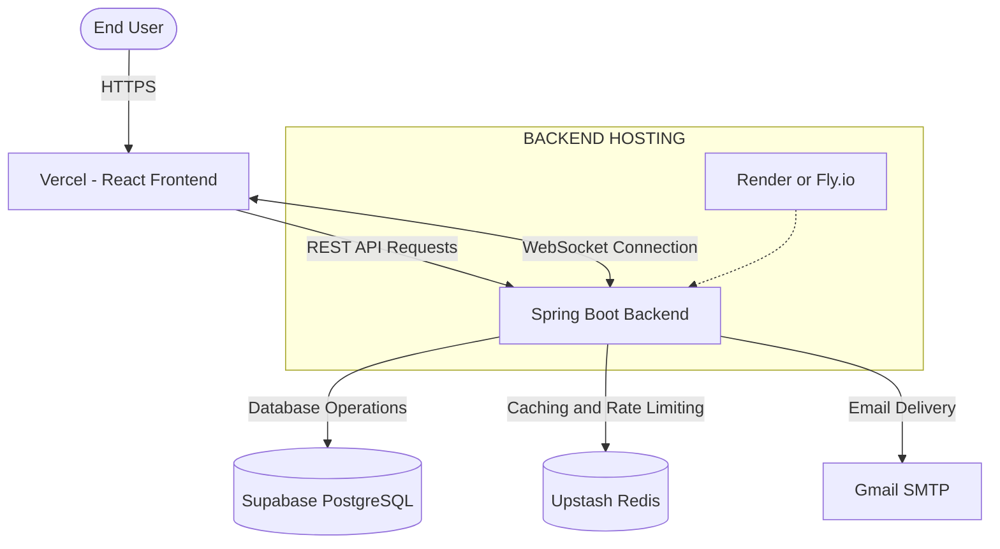

---

## 12. FEATURE COMPLETION MAP

```mermaid
flowchart TD
    ROOT["NEXUS ARENA"]

    ROOT --> SECURITY["SECURITY AND AUTHENTICATION"]
    ROOT --> GAME["MULTIPLAYER GAMING"]
    ROOT --> INFRA["INFRASTRUCTURE"]
    ROOT --> DEPLOY["CLOUD DEPLOYMENT"]

    SECURITY --> S1["RSA-256 JWT Authentication"]
    SECURITY --> S2["Refresh Token Rotation"]
    SECURITY --> S3["Two-Factor Authentication"]
    SECURITY --> S4["OTP Verification"]
    SECURITY --> S5["HttpOnly Cookies"]
    SECURITY --> S6["Account Lockout"]
    SECURITY --> S7["Email Verification"]
    SECURITY --> S8["Role-Based Access Control"]
    SECURITY --> S9["Redis Rate Limiting"]

    GAME --> G1["WebSocket Integration"]
    GAME --> G2["Private Game Rooms"]
    GAME --> G3["6-Digit Room Codes"]
    GAME --> G4["Real-Time Game Updates"]
    GAME --> G5["Victory Animations"]

    INFRA --> I1["PostgreSQL"]
    INFRA --> I2["Redis"]
    INFRA --> I3["Flyway Migrations"]
    INFRA --> I4["Docker"]

    DEPLOY --> D1["Vercel Frontend"]
    DEPLOY --> D2["Cloud Backend"]
    DEPLOY --> D3["Supabase Database"]
    DEPLOY --> D4["Upstash Redis"]
```

---

## 13. LOCAL DEVELOPMENT WORKFLOW

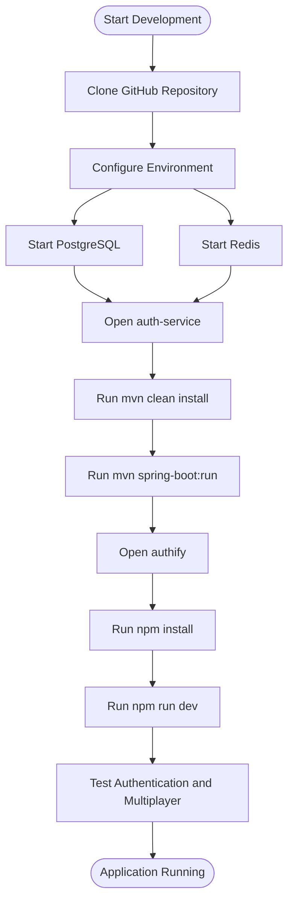

### COMMAND REFERENCE

```bash
# Clone repository
git clone https://github.com/AnshCyberSec/nexus-arena.git

cd nexus-arena

# Backend
cd auth-service
mvn clean install
mvn spring-boot:run

# Frontend - open a separate terminal
cd nexus-arena/authify
npm install
npm run dev
```

---

## 14. ENGINEERING HIGHLIGHTS

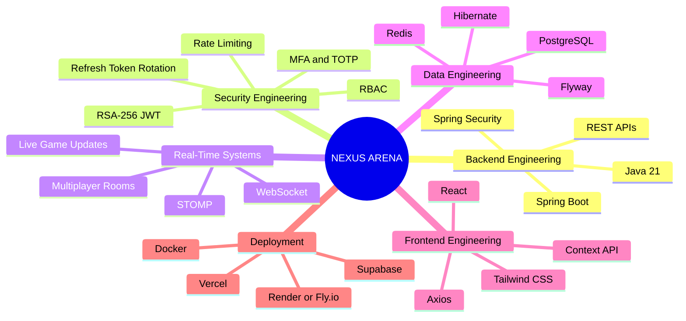

---

## 15. AUTHOR

<div align="center">

### ANSHUMAN DALABE HERA

**Full Stack Developer | Java Backend Developer | Cybersecurity Enthusiast**

[GitHub — AnshCyberSec](https://github.com/AnshCyberSec)

### BUILD. SECURE. CONNECT. COMPETE.

**WELCOME TO NEXUS ARENA.**

⭐ If you like this project, consider giving it a star!

</div>
